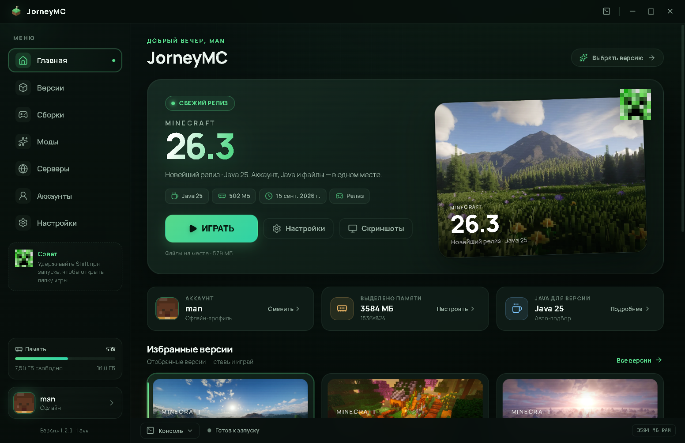
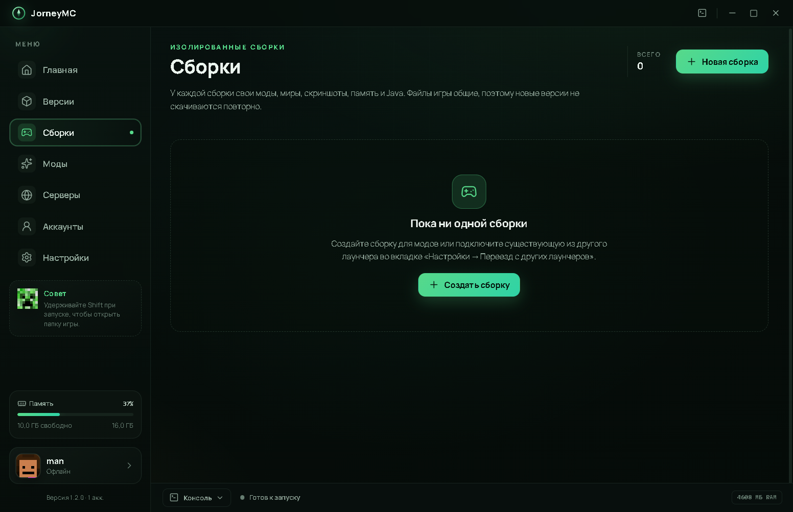
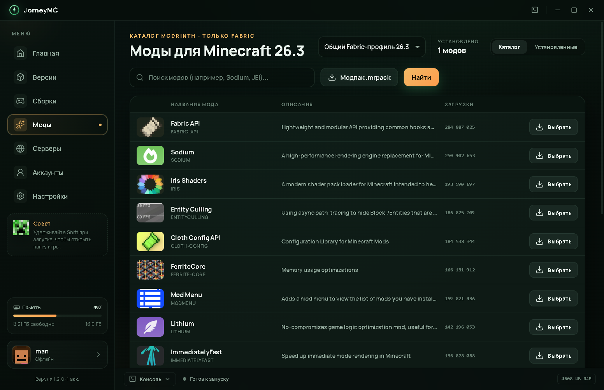
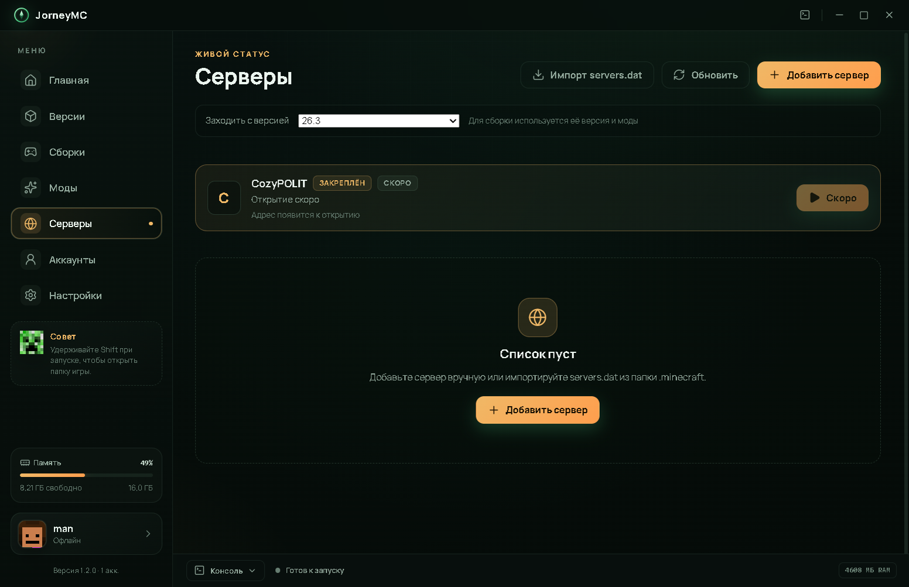
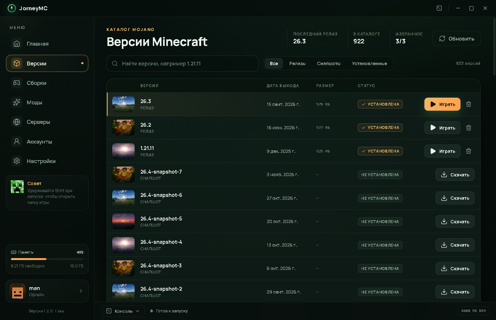
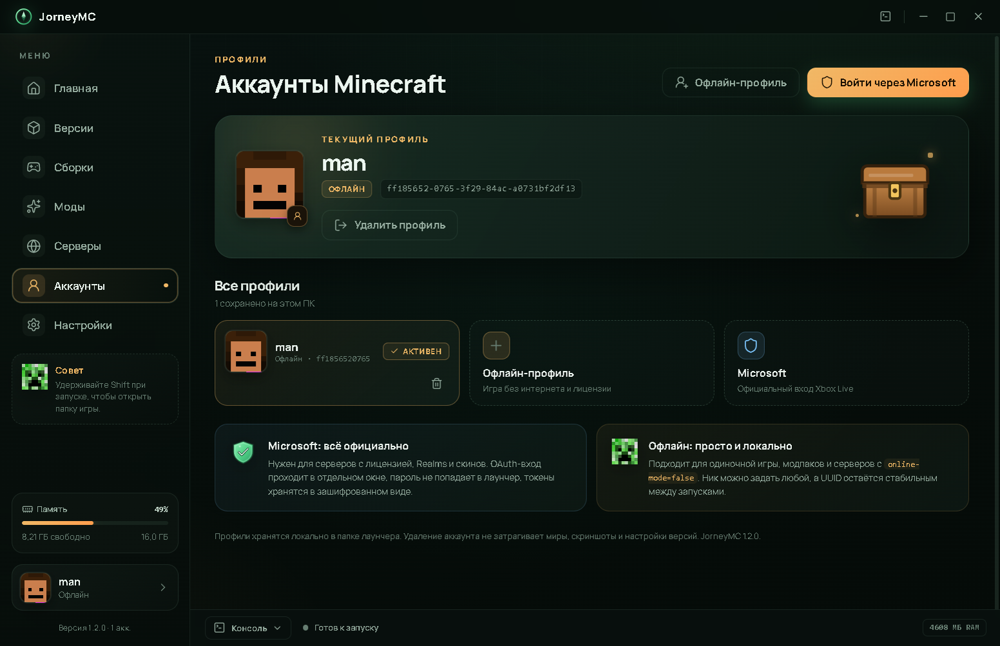
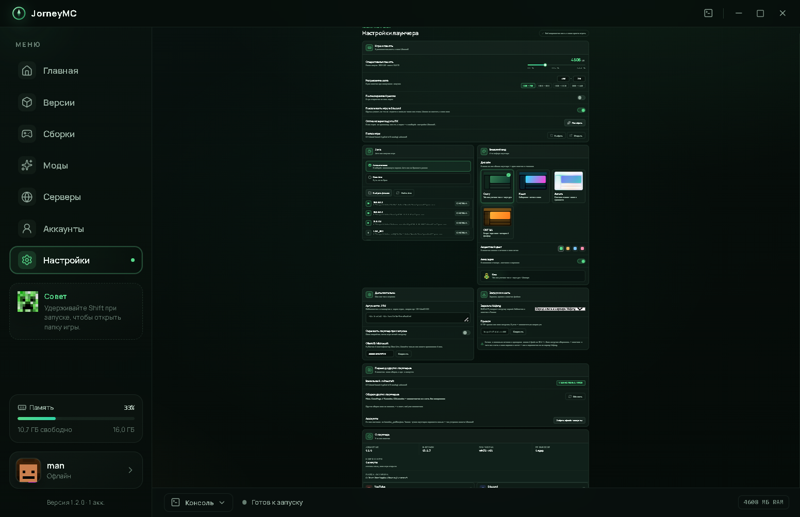

# JourneyMC

Уютный лаунчер Minecraft для Windows: версии Mojang, изолированные сборки, каталог модов Modrinth, серверы с живым пингом, разбор крашей, импорт из других лаунчеров, офлайн-профили и вход через Microsoft. Тёмный интерфейс, собственные SVG-иллюстрации, четыре акцентные темы.



| Сборки | Моды для сборки | Серверы |
| --- | --- | --- |
|  |  |  |

| Версии | Аккаунты | Настройки |
| --- | --- | --- |
|  |  |  |

## Возможности

**Версии и запуск**

- Каталог версий Mojang (922 версии в текущем манифесте), поиск и фильтры по релизам, снапшотам и установленным.
- Установка клиента, библиотек и ассетов с проверкой SHA-1 и распаковкой нативов; прогресс, отмена, удаление.
- Запуск игры с подбором Java: системные JDK или автоматическая загрузка рантайма Mojang (Java 21 для 1.21.11, Java 25 для 26.x).
- Докачка после обрыва по HTTP Range, повторная проверка хешей и параллельные загрузки.

**Сборки**

- Изолированные сборки: у каждой своя папка модов, миров, скриншотов, конфигов, свой лимит памяти и своя Java. Файлы версии (клиент, библиотеки, ассеты) общие, поэтому версии не скачиваются повторно.
- Клонирование сборки, открытие папки, переименование, удаление.
- Сборки других лаунчеров подключаются **на месте** (`external: true`): игра читает существующую папку, ничего не копируя. Копию можно сделать клонированием.
- Запуск «без модов» (safe-mode) для любой сборки: папка `mods` временно убирается в `mods.cozy-safe-disabled` и возвращается после выхода из игры.
- Проверка целостности модов именно этой сборки перед запуском.

**Моды (Modrinth, Fabric)**

- Каталог Modrinth: поиск, фильтры по загрузкам и дате, карточки с иконками и описаниями, вкладка установленных, включение и выключение модов.
- Автоматическая установка Fabric: лаунчер сам создаёт профиль загрузчика под выбранную версию игры.
- Выбор цели установки: общий Fabric-профиль версии или конкретная сборка. Для сборки моды лежат в её собственной папке и не задевают другие сборки.
- Разрешение зависимостей Modrinth: обязательные зависимости (Fabric API и т. п.) скачиваются автоматически, опциональные показываются в предпросмотре и ставятся по желанию. Циклы, несовместимости и лимиты (60 файлов / 400 МБ) обрабатываются.
- Проверка перед запуском: моды сверяются по SHA-1/SHA-512 и при необходимости перекачиваются. Установка `.mrpack` с защитой от zip-slip.
- Проверка обновлений модов: список доступных обновлений, обновление по одному или всех сразу.

**Серверы**

- Список серверов, избранное, живой статус через Server List Ping (онлайн, игроки, задержка), автообновление раз в 45 секунд.
- Подключение сразу с загрузкой: выбирается версия или сборка, лаунчер запускает игру с `--server`/`--port`.
- Импорт `servers.dat` из `.minecraft` и из папок сборок.
- Закреплённая карточка CozyPOLIT: пока адрес не объявлен, вместо пинга показывается «скоро», а вместо кнопки запуска — «Открытие скоро». Конфигурация берётся из `cozypolit.json` с GitHub и кэшируется.

**Разбор крашей**

- При ненулевом коде выхода лаунчер читает `crash-reports/`, `logs/latest.log` и вывод процесса, выделяет сигнатуру и вероятных виновников среди модов.
- Карточка краша: что случилось, что попробовать, память, число модов, код выхода.
- Действия в один клик: «Запустить без модов», «+2 ГБ памяти», «Отключить последний мод», открыть или скопировать отчёт, выгрузить на mclo.gs.

**Импорт из других лаунчеров**

- Поиск сборок Prism Launcher/PolyMC/MultiMC, CurseForge, ATLauncher, GDLauncher.
- Подключение найденной сборки на месте или запуск её версии ванильно.
- Импорт офлайн-аккаунтов из `launcher_profiles.json`.

**Сеть и обновления**

- Зеркало Mojang: официальные серверы или BMCLAPI (`bmclapi2.bangbang93.com`) с автоматическим откатом на официальные при ошибке.
- HTTP-прокси для всех загрузок (через `undici` ProxyAgent).
- Автообновление лаунчера через GitHub Releases (`electron-updater`): проверка при старте и раз в сутки, прогресс загрузки, установка по кнопке.

**Аккаунты и интерфейс**

- Офлайн-профили с детерминированным UUID и пиксельными аватарами.
- Вход через Microsoft: OAuth в отдельном окне, Xbox Live / XSTS, проверка лицензии Java Edition, загрузка скина. Токены хранятся в зашифрованном виде через `safeStorage`.
- Настройки: память, разрешение и пресеты, полный экран, папка игры, Java (авто/вручную), акцентный цвет, анимации, JVM-аргументы, скрытие лаунчера при запуске.
- Консоль запуска с живыми логами и кнопкой остановки, уведомления о прогрессе и ошибках.

## Быстрый старт

Готовые сборки лежат в `release/`:

- `JourneyMC-Setup-1.2.0.exe` — установщик NSIS (ярлыки на рабочем столе и в меню «Пуск»).
- `JourneyMC-Portable-1.2.0.exe` — портативная версия, не требует установки.

Требования: Windows 10/11 x64, интернет для загрузки версий и входа в Microsoft. Java не обязательна — лаунчер найдёт системную или скачает нужный рантайм.

Контрольные суммы SHA-256 (файл `release/SHA256SUMS.txt` создаётся командой `npm run sums`):

```text
4e19ce58b66bda6607ccbff1e04eeca0b447c3421e7e2af03827114858b963ca  JourneyMC-Portable-1.2.0.exe
cd780b26344e1aa18c1d439d190a06b9c224f04fa7473f11bf71258268b9f76f  JourneyMC-Setup-1.2.0.exe
```

## Сборки

Сборка — это папка `%APPDATA%\cozy-launcher\instances\<id>\game` со своими `mods`, `saves`, `screenshots`, `resourcepacks`, `shaderpacks`, `config`, `logs`. Клиент, библиотеки, ассеты и нативы берутся из общей папки игры, поэтому новая сборка не занимает место версией.

- Реестр сборок: `%APPDATA%\cozy-launcher\instances.json`.
- Моды сборки индексируются под ключом `instance:<id>` в `mods-index.json`; общий Fabric-профиль версии — под id профиля.
- У каждой сборки свои `ramMb` и `javaPath`; при запуске они перекрывают глобальные настройки.
- «Играть» запускает сборку в её папке, «Без модов» — safe-mode: `mods` переименовывается в `mods.cozy-safe-disabled` до запуска и восстанавливается после остановки или краша.

## Моды и Fabric

1. Во вкладке «Моды» выберите цель: общий Fabric-профиль версии или конкретную сборку.
2. Нажмите «Установить»: если профиль Fabric ещё не создан, он появится автоматически (`<версия>-fabric-loader-<версия>`).
3. Обязательные зависимости загружаются сами. Опциональные и несовместимые моды перечислены в окне предпросмотра.
4. Запускайте игру из лаунчера: моды лежат отдельно от ванильного профиля, поэтому обычный клиент остаётся чистым.
5. Поддерживаются проверка обновлений, включение/выключение отдельных модов, удаление и установка `.mrpack`-модпаков.

Файлы модов: `%APPDATA%\.minecraft\versions\<профиль>\run\mods\` для общего профиля и `<папка сборки>\mods\` для сборки. Реестр установленного: `%APPDATA%\cozy-launcher\mods-index.json`.

## Серверы

- Адрес можно вводить как `host`, `host:port` или `host:port` с пробелами — порт по умолчанию 25565.
- Пинг идёт напрямую по протоколу Server List Ping, без внешних API.
- «Заходить с версией» запускает выбранную версию или сборку с `--server <host> --port <port>`.
- Импорт читает `servers.dat` (NBT) из общей папки игры и из папок сборок; дубликаты по адресу не добавляются.
- Список серверов: `%APPDATA%\cozy-launcher\servers.json`.

## Разбор крашей

После аварийного завершения игры открывается карточка краша. Лаунчер ищет свежий отчёт в `crash-reports/`, строки-причины в `latest.log` и вывод процесса, сопоставляет их с установленными модами и памятью.

- «Запустить без модов» — перезапуск в safe-mode.
- «+2 ГБ памяти» — поднимает `ramMb` на 2048 и перезапускает.
- «Отключить последний мод» — выключает последний установленный `.jar`.
- «Открыть отчёт», «Скопировать отчёт», «Загрузить на mclo.gs» (https://api.mclo.gs/1/log).

## Импорт из других лаунчеров

Настройки → «Импорт из других лаунчеров». Сканирование ищет папки Prism/PolyMC/MultiMC, CurseForge, ATLauncher и GDLauncher. Найденную сборку можно подключить как внешнюю (файлы остаются на месте) или запустить её версию ванильно, без модов. Офлайн-аккаунты импортируются из `launcher_profiles.json`.

## Зеркала и прокси

- Зеркало Mojang переключается в настройках: `official` или `bmclapi`. При сетевой ошибке зеркала лаунчер повторяет запрос на официальном сервере.
- Прокси задаётся строкой `http://host:port`; настройка применяется ко всем загрузкам сразу и не требует перезапуска.
- Недокачанные файлы возобновляются по Range, после загрузки хеш проверяется повторно.

## Обновления лаунчера

Сборка публикуется в GitHub Releases репозитория `sharrrrra1/CozyLauncher`. `electron-updater` проверяет обновления при запуске и раз в сутки (канал `stable`), показывает баннер на главной, качает обновление с прогрессом и устанавливает по кнопке.

Ручная публикация релиза:

```bash
npm run dist
# загрузите в GitHub Release с тегом v1.2.0:
#   release/JourneyMC-Setup-1.2.0.exe
#   release/JourneyMC-Setup-1.2.0.exe.blockmap
#   release/JourneyMC-Portable-1.2.0.exe
#   release/latest.yml
#   release/SHA256SUMS.txt
```

Для собственного сервера обновлений задайте `settings.updateServerUrl` — тогда используется HTTP-фолбэк с `latest.yml`.

## Разработка

```bash
npm install
npm run dev        # запуск с горячей перезагрузкой
npm run typecheck  # проверка TypeScript
npm test           # unit-тесты ядра
npm run icons      # генерация build/icon.png и screenshots/icon.png
npm run sprites    # пиксель-спрайты из текстур клиента Minecraft
npm run screenshot # снимки интерфейса в screenshots/
npm run dist       # сборка установщика и портативной версии
npm run sums       # SHA-256 для собранных .exe → release/SHA256SUMS.txt
```

Если GitHub недоступен для бинарников electron-builder, сборка запускается через зеркало:

```bash
ELECTRON_BUILDER_BINARIES_MIRROR=https://npmmirror.com/mirrors/electron-builder-binaries/ npm run dist
```

Стек: Electron 45, React 19, TypeScript 5.9, electron-vite 6, electron-builder 26. Архитектура: `src/main` (ядро и IPC), `src/preload` (типизированный мост), `src/renderer` (React UI), `src/shared` (общие типы). Тесты ядра: `tests/launcher-features.test.ts`.

## Данные и приватность

- Настройки, аккаунты, реестр сборок и серверов: `%APPDATA%\cozy-launcher\`.
- Игра по умолчанию: `%APPDATA%\.minecraft` (меняется в настройках).
- Сборки: `%APPDATA%\cozy-launcher\instances\<id>\game\`.
- Логи запусков: `%APPDATA%\cozy-launcher\logs\`; отчёты крашей — в `crash-reports/` папки игры или сборки.
- Скины Microsoft загружаются напрямую с доменов `minecraft.net` / `mojang.com` и кэшируются в памяти на 10 минут. Сторонние сервисы не используются, кроме добровольной выгрузки отчёта на mclo.gs.

## Арт интерфейса

- Обложки версий — реальные игровые скриншоты (`src/renderer/src/assets/art/`).
- Пиксель-спрайты (крипер, алмаз, зелье, сердце, бутылка опыта, куб травы) собраны из текстур установленного клиента: `npm run sprites` читает `client.jar`, складывает оригиналы в `raw_art/mc/`, а готовые PNG — в `src/renderer/src/assets/mc/`. Масштабирование только целое (nearest), поэтому пиксели остаются резкими; размер в CSS px кратен стороне тексела.
- Грань травы перекрашена байомным tint'ом равнин, зелье тонировано маской `potion_overlay.png` — оба приёма повторяют то, как игра рисует эти текстуры.

## Проверка

- `npm run typecheck` — без ошибок.
- `npm test` — 35 тестов: правила версий, слияние наследования, синтез Fabric-профиля, classpath, нативы, аргументы, UUID, никнеймы, кэш Java, разрешение зависимостей, безопасные пути `.mrpack`, схема CozyPOLIT, сравнение версий обновлений, разбор крашей, `servers.dat`, пинг серверов и зеркала загрузок.
- Smoke-тесты реального запуска (офлайн-профиль `CozyTester`): `1.21.11` на Java 21 и `26.3` / `26.2` на Java 25 доходят до главного меню; отчёты в `smoke/smoke-*.json`.
- Полный smoke модов: установка Fabric + модов из Modrinth, проверка зависимостей, pre-launch верификация и запуск до главного меню — `smoke-mods/mods-smoke-<версия>.json` (`success: true`).
- Smoke сборки и безопасного режима: `COZY_INSTANCE_SMOKE=1.21.4 COZY_SMOKE_OUT=<папка> <electron> .` создаёт временную сборку, кладёт dummy-мод, запускает её в safe-mode и проверяет, что мод скрыт во время игры и возвращён после остановки — `smoke/instance-smoke-1.21.4.json` (`success: true`).

## Ограничения

- Поддерживаются только Fabric-моды из Modrinth; ванильные запуски не затрагиваются.
- Внешние сборки подключаются на месте и не копируются; копию можно получить клонированием.
- Вход Microsoft нельзя проверить автоматически: нужен аккаунт с лицензией Minecraft Java Edition. Окно OAuth, обмен кода и цепочка Xbox проверяются вручную.
- Каталог версий зависит от доступности `piston-meta.mojang.com`.
- Проект не связан с Mojang Studios или Microsoft. Minecraft — торговая марка Mojang Studios.
